# Architecture

Structural overview of `ng-openapi-signals`: how the CLI, the configuration
layer and the code generator fit together, which invariants the generated
output guarantees, and where to add code.

For behaviour of the *generated* client (runtime API, middleware, error
types), see [RUNTIME.md](./RUNTIME.md). For usage, CLI flags and configuration,
see the [README](../README.md), [CLI.md](./CLI.md) and
[CONFIGURATION.md](./CONFIGURATION.md).

---

## Overview

`ng-openapi-signals` is a CLI-first, build-time code generator. It reads an
OpenAPI 3.x document (JSON or YAML), renders a set of TypeScript files in
memory, formats them with Prettier and writes them to a single output
directory.

```text
GET endpoints
→ Angular resource() + fetch()

POST / PUT / PATCH / DELETE endpoints
→ Promise-based fetch() methods
```

The generated client uses native `fetch()` by default and never depends on
Angular `HttpClient` or RxJS. The optional `httpClient` transport replaces only
the client runtime, not the generated service methods; it is the only mode that
imports `@angular/common/http` and `rxjs`.

## Design principles

1. **Generation is in-memory and side-effect free apart from reads.** The
   generator builds a `Record<relativePath, fileContent>`; writes happen only
   in `writeFiles()`. This is what makes `--dry-run` and `--check` share the
   same code path as a normal run.
2. **Output is deterministic.** No locale-dependent sorting in the generator, no
   timestamps, no filesystem ordering. Identical input and config produce
   byte-identical output.
3. **One decision per name.** A schema name is resolved once
   (`buildModelNames()`) and reused for the declaration and every `$ref`; file
   names are derived from that resolved name. Renames and de-duplication
   therefore cannot drift between a type and its references.
4. **Generated code must compile.** The generator optimises for output that
   type-checks under the repository's compiler settings (`strict`,
   `noUncheckedIndexedAccess`, `exactOptionalPropertyTypes`) and stays
   compatible with `verbatimModuleSyntax` / `isolatedModules` consumers.
5. **Small runtime.** No framework of its own — a handful of plain TypeScript
   files, no RxJS in the default `fetch` transport, no hard-coded auth tokens.

## Pipeline

```mermaid
flowchart TD
    A[cli.ts] --> B[Load config file<br/>config.ts + jiti]
    A --> C[Normalize CLI flags<br/>cli-options.ts]
    B --> D[Merge precedence: defaults, file, CLI<br/>resolveConfig]
    C --> D
    D --> E[Validate<br/>validateConfig]
    E --> F{Mode}
    F -->|"generate"| G[generateFiles + formatFiles]
    F -->|"--dry-run"| G
    F -->|"--check"| T[checkFiles]
    G -->|"generate"| W[writeFiles]
    G -->|"--dry-run"| L[List paths + line counts]
    T --> CMP[Compare with disk, no writes]
```



`generateFiles()` performs the actual work, in this order:

1. `loadOpenApi()` — parse and bundle the document.
2. `hoistInlineSchemas()` — lift anonymous object schemas into
   `components.schemas`.
3. `buildModelNames()` — resolve every schema key to its emitted type name.
4. `extractSchemas()` → `generateModelFiles()` — `models/*.ts` plus barrel.
5. `extractOperations()` → `generateApiFiles()` — `resources/*.api.ts` plus
   barrel.
6. `generateRuntimeFiles()` — runtime modules for the configured transport.
7. `generateIndexFile()` — root barrel.

`formatFiles()` then runs Prettier over every file and prepends the header;
only the step after that differs per mode. `--check` never writes: it calls
`generateFiles()` + `formatFiles()` itself and compares the formatted map
against the files on disk.

## Repository layout

```text
ng-openapi-signals/
  src/
    cli.ts               # commander program
    cli-options.ts       # CLI flags → PartialGeneratorConfig
    config.ts            # defaults, loadConfig, resolveConfig, validateConfig
    generate.ts          # generateFiles / formatFiles / writeFiles / generate
    check.ts             # --check comparison
    openapi.ts           # document loading (swagger-parser bundle)
    logger.ts            # TTY-aware ANSI logger
    codegen/
      types.ts           # config + model types
      document.ts        # permissive OpenAPI shape, $ref helpers
      guards.ts          # type guards for the config unions
      naming.ts          # identifiers, reserved names, ModelNames
      schema-to-ts.ts    # schema → TypeScript type expression
      model-refs.ts      # positive model-reference scan
      inline-schemas.ts  # hoist anonymous schemas
      generate-models.ts # models/ files + barrel
      generate-api.ts    # resources/ files + barrel
      generate-runtime.ts
      runtime/           # one module per generated runtime file
  tests/                 # vitest suites, fixtures, snapshots, helpers
  examples/              # example spec + config + generated output (ignored by git)
  docs/                  # architecture, runtime topics, CLI, config, usage
  .github/workflows/     # CI (lint, build, generate, test, --check, release checks)
```

## Module map

### CLI layer

- [src/cli.ts](../src/cli.ts) — Commander program, option definitions, the
  `generate` command and exit codes. The reported version is injected at build
  time (`__PKG_VERSION__`).
- [src/cli-options.ts](../src/cli-options.ts) — converts raw commander values
  into a `PartialGeneratorConfig` and rejects invalid enum-like values
  (`--transport`, `--group-by`, `--default-query-style`, `--default-query-explode`).
- [src/logger.ts](../src/logger.ts) — minimal ANSI logger writing to `stderr`;
  disables colour when not a TTY and gates `detail()` behind `--verbose`.
- [src/check.ts](../src/check.ts) — the `--check` implementation: in-memory
  generation compared against disk, no writes.

Exit codes: `0` on success and on a passing check, `1` on any thrown error or a
failing check. Errors are printed via the logger; stack traces only with
`--verbose`.

`--check` classifies every generated file against disk as `matched`,
`outdated`, `outdatedEol` (differs only in CRLF vs LF), `missing` or `stale`
(on disk, no longer produced). Only `outdated` and `missing` fail the check;
`--fail-on-stale` additionally makes `stale` fatal, while `outdatedEol` only
warns because the content is identical.

### Configuration layer

- [src/config.ts](../src/config.ts) — defaults (`DEFAULT_CONFIG`,
  `DEFAULT_RUNTIME_CONFIG`, `DEFAULT_CONFIG_FILE`), `defineConfig()`,
  `loadConfig()`, `resolveConfig()` and `validateConfig()`. This module is the
  package's only public entry point besides the CLI binary: `package.json`
  exports it as `ng-openapi-signals/config` (types + ESM).
- [src/codegen/guards.ts](../src/codegen/guards.ts) — pure type guards
  (`isGroupBy`, `isTransport`, `isQueryStyle`), re-exported by `config.ts` for
  backwards compatibility.

Precedence is **CLI > config file > defaults**. The nested `runtime` object is
deep-merged field by field, so a partial `runtime` block never resets
unrelated options.

`loadConfig()` loads `ng-openapi-signals.config.ts` through `jiti`, which
makes a TypeScript config file executable without a build step. A config file
requested explicitly via `--config` must exist; only the implicit default file
may be absent.

### Generation orchestration

[src/generate.ts](../src/generate.ts) exposes four functions:

- `generateFiles()` — reads the spec. Loads the document, hoists inline
  schemas, resolves names, extracts models and operations, and returns the raw
  (unformatted) file map.
- `formatFiles()` — reads the project's Prettier config. Formats every file and
  prepends the auto-generated header.
- `writeFiles()` — writes. Optionally wipes the output directory, creates
  parent directories and writes files in parallel.
- `generate()` — writes. Convenience wrapper:
  `generateFiles` → `formatFiles` → `writeFiles`.

Formatting details worth knowing:

- The project's own Prettier configuration is resolved from the **output
  directory** and merged over the generator defaults (`singleQuote: true`,
  `trailingComma: 'none'`, `parser: 'typescript'`). Resolution is memoised per
  directory and failures fall back to the defaults, so an unrelated broken
  Prettier config never fails generation.
- The header is prepended idempotently, so re-formatting an already-headered
  file does not duplicate it.

`writeFiles()` guards against destructive `clean` values: a filesystem root,
the current working directory or one of its ancestors is rejected instead of
being removed recursively.

### Codegen layer

These modules hold no CLI state and perform no writes. The spec file is read
once, in `src/openapi.ts` (listed below for completeness, although it lives
next to `codegen/` rather than inside it).

- [src/openapi.ts](../src/openapi.ts) — loads and parses the document with
  `SwaggerParser.bundle()` (not `dereference()`, so `$ref`s to schemas
  survive). Also declares the permissive `OpenAPISchema` shape.
- [src/codegen/types.ts](../src/codegen/types.ts) — config and model types:
  `GeneratorConfig`, `RuntimeConfig`, `OperationModel`, `SchemaModel`,
  `ParameterModel`, `RequestBodyModel`.
- [src/codegen/document.ts](../src/codegen/document.ts) — permissive OpenAPI
  document shape used by the traversal, plus `isReference()` and
  `RefResolver`.
- [src/codegen/inline-schemas.ts](../src/codegen/inline-schemas.ts) —
  `hoistInlineSchemas()`: extracts anonymous object schemas into
  `components.schemas` and replaces them with `$ref`s.
- [src/codegen/naming.ts](../src/codegen/naming.ts) — identifier sanitising,
  case conversion, reserved-name sets, `buildModelNames()` and collision-free
  file/member names.
- [src/codegen/schema-to-ts.ts](../src/codegen/schema-to-ts.ts) —
  `schemaToTsType()`: OpenAPI schema → TypeScript type expression.
- [src/codegen/model-refs.ts](../src/codegen/model-refs.ts) —
  `collectModelReferences()`: positive scan for model references inside a
  rendered type expression.
- [src/codegen/generate-models.ts](../src/codegen/generate-models.ts) —
  `extractSchemas()` and `generateModelFiles()`: one file per model plus
  `models/index.ts`.
- [src/codegen/generate-api.ts](../src/codegen/generate-api.ts) —
  `extractOperations()` and `generateApiFiles()`: parameter merging,
  response/body extraction, grouping, service rendering.
- [src/codegen/generate-runtime.ts](../src/codegen/generate-runtime.ts) —
  `generateRuntimeFiles()`: dispatches to the `runtime/*` templates and selects
  optional files.

`extractSchemas()` receives the resolved `ModelNames` map so each declaration is
rendered through it, and `extractOperations()`/`generateApiFiles()` take the
same map — it is the single contract between declaration, import and `$ref`
rendering.

#### Naming and identifiers

`naming.ts` owns one decision, with four documented reasons a schema name
cannot be emitted verbatim:

- `RESERVED_TYPE_NAMES` — the declaration itself does not parse, e.g.
  `default` → `Default`.
- `RESERVED_GLOBAL_TYPE_NAMES` — the declaration shadows a built-in that the
  same module emits, e.g. `Record` → `RecordModel`.
- `RESERVED_RESOURCE_BINDING_NAMES` — the resource template already binds that
  identifier by name, e.g. `Service` → `ServiceModel`.
- `RESERVED_ROOT_EXPORT_NAMES` — the root barrel would re-export the name
  twice (TS2308), e.g. `ApiError` → `ApiErrorModel`.

`sanitizeTypeName()` is the only place these are applied: it makes the name a
valid PascalCase identifier (leading digits get a `_` prefix), renames reserved
words, then appends `Model` for the three collision sets. De-duplication
happens afterwards in two separate namespaces: `buildModelNames()` uses
`uniqueIdentifier()` for declaration names (case-sensitive), while
`generateModelFiles()` / `generateApiFiles()` use `uniqueFileName()` for file
names (case-insensitive, because Windows and macOS file systems are).

Renames are **configuration-independent**: a name is renamed even when the
module that would collide is not emitted in the current configuration, so the
declaration name for a given spec never depends on generator options.

#### Inline schema hoisting

`hoistInlineSchemas()` walks `components.schemas` and `paths` and registers
anonymous object schemas (those with `properties`, or a composition) under a
derived PascalCase name:

- Property of a named schema → `<ParentSchema><PropertyName>`
- Operation response body → `<operationId>Response`
- Operation request body → `<operationId>Request`
- Operation parameter → `<operationId><ParamName>`
- Fallback → `InlineSchema`, `InlineSchema2`, …

After this pass every structured inline schema is a `$ref`, so the remaining
stages only need the existing `$ref` handling.

#### Model references

`model-refs.ts` answers "which identifiers in this TypeScript type expression
are declared models?" with a **positive** rule: a token counts iff it appears
in the document's resolved `ModelNames` set. String-literal types and
object-literal member names are stripped first, so an enum value or property
key named like a model is not imported. Keywords, punctuation and globals need
no special cases, because no declared model can carry one of those names (see
`RESERVED_GLOBAL_TYPE_NAMES`).

This one function feeds the import lists of model files and resource files,
which is why the two cannot drift apart.

#### Models

`extractSchemas()` classifies every schema as `interface`, `enum` or `alias`:

- `enum` → named union type (`x-enumNames` / `x-enum-varnames` supported)
- composition-only, primitive, `additionalProperties`-only, nullable object
  and bare `type: object` → type alias
- object with properties → interface

`generateModelFiles()` renders one file per model (kebab-case name) plus a
barrel. Model files import each other **directly** (`./user`, never
`./index`), which avoids a per-model import cycle. An empty barrel emits
`export {};` so it remains a module.

#### API services

`extractOperations()` walks `paths` × GET/POST/PUT/PATCH/DELETE and produces
`OperationModel`s:

- Path-item parameters and operation parameters are merged by `(name, in)`
  after `$ref` resolution; the operation-level value replaces the path-item
  one in place.
- Parameters are split by location, then keyed by `assignParamKeys()` —
  colliding names in different locations become `idPath` / `idQuery` /
  `idHeader`.
- `operationId` falls back to a method/path-derived name when absent.
- The response type unions all 2xx schemas, prefers a `default` response when
  no 2xx schema exists, returns `unknown` for a non-204 2xx response without a
  schema, `void` when nothing usable is declared, and
  `ReadableStream<Uint8Array> | null` for stream responses.
- The request body picks `preferContentType` → `application/json` → first
  entry with a schema, and records multipart/form-data parts.

`generateApiFiles()` groups operations by tag (default) or first path segment,
assigns collision-free file and class names (the class-name set is disjoint
from **all** model names in the document), and renders one
`resources/<name>.api.ts` per group plus a barrel. Method-name collisions from
duplicate `operationId`s are suffixed, with the derived `…Resource` /
`…Mutation` names reserved as well.

### Runtime templates

[src/codegen/runtime/](../src/codegen/runtime) contains one module per
generated output file. Each module exports a `generate…()` function returning
the file content as a string.

- `providers-fetch.ts` → `providers.ts`, `transport: 'fetch'` (default).
- `providers-http-client.ts` → `providers.ts`, `transport: 'httpClient'`.
- `api-error.ts` → `api-error.ts`, always emitted with a transport-specific
  body.
- `api-fetch-client.ts` → `api-fetch-client.ts`, `transport: 'fetch'`.
- `api-http-client.ts` → `api-http-client.ts`, `transport: 'httpClient'`.
- `signal-utils.ts` → `signal-utils.ts`, always (`MaybeSignal`,
  `readSignalOrValue`).
- `mutation-utils.ts` → `mutation-utils.ts`, only with `signalMutations: true`.
- `date-utils.ts` → `date-utils.ts`, only with `dateTransformer: true`.
- `shared.ts` → no output file; codegen helper (`objectLiteral()` for header
  defaults).

`generate-runtime.ts` is a slim orchestrator: it picks the transport branch and
spreads in the optional files.

`index.ts` is generated by `generateIndexFile()` in
[src/generate.ts](../src/generate.ts) and re-exports exactly the modules that
exist for the current configuration.

## Build and packaging

- **Build** — `tsdown` ([tsdown.config.ts](../tsdown.config.ts)) bundles two
  entries, `src/cli.ts` and `src/config.ts`, as ESM for Node 22 with a
  `#!/usr/bin/env node` banner. `__PKG_VERSION__` is replaced with the version
  from `package.json` at build time, so `--version` can never drift.
- **Package surface** — `package.json` ships `dist/`, `README.md` and
  `LICENSE`. `bin` exposes `dist/cli.mjs`; `exports` exposes only
  `./config` (`dist/config.mjs` + `dist/config.d.mts`). Everything else is
  internal.
- **Engines** — Node `>=22.19.0`; Angular `>=22.0.0` as a peer dependency.
- **Release gates** — `publint`, `@arethetypeswrong/cli` and `knip` run in CI
  ([.github/workflows/ci.yml](../.github/workflows/ci.yml)). [knip.json](../knip.json)
  suppresses unused-type/export findings for `src/codegen/types.ts`,
  `src/codegen/generate-models.ts` and `src/generate.ts`, whose exports exist
  for tests and internal composition rather than the public package surface.
- **CI order** — install → lint → build → `generate:example` → test →
  `check:example -- --fail-on-stale`, plus a separate release-checks job.

## Generated output layout

```text
<output>/
  providers.ts
  api-error.ts
  api-fetch-client.ts        # or api-http-client.ts
  signal-utils.ts
  mutation-utils.ts          # only with runtime.signalMutations
  date-utils.ts              # only with runtime.dateTransformer
  index.ts
  models/
    <kebab-case>.ts          # one declaration per schema
    index.ts
  resources/
    <group>.api.ts           # one service class per tag / path group
    index.ts
```

Every file starts with:

```ts
// Auto-generated by ng-openapi-signals.
// Do not edit manually.
```

## Invariants

- **GET → `resource()`.** Read operations are generated as
  `…Resource(params)` returning an Angular `resource()`; params may be plain
  values or signals (`MaybeSignal<T>`), and the params factory may return
  `undefined` to keep the resource idle.
- **Mutations → `Promise`.** POST/PUT/PATCH/DELETE produce
  `Promise`-returning methods. `runtime.signalMutations` *adds* a
  `…Mutation()` wrapper (strictly additive).
- **No `HttpClient`, no RxJS by default.** Only the opt-in `httpClient`
  transport introduces `@angular/common/http` and `rxjs`.
- **Deterministic output.** Sorted import lists use code-unit order (not
  locale-dependent comparison); file order derives from the spec.
- **Compile-safe names.** Emitted names never collide with keywords, emitted
  globals, resource-template bindings or runtime exports.
- **No manual edits.** Generated files are replaced on every run; changes
  belong in the spec or the generator config.

## Testing strategy

Tests live in [tests/](../tests) and run with Vitest
([vitest.config.ts](../vitest.config.ts); the timeout is raised to 20 s because
several suites run the full generator — spec parsing, hoisting and Prettier
over the whole tree, sometimes twice).

- **Unit (pure codegen)** — e.g. `model-refs`, `inline-schemas`, `config`,
  `cli-options` and the `robustness` suite.
- **Fixture-driven** — `fixtures.test.ts` discovers every
  `tests/fixtures/*.yml` automatically, so a new fixture is covered without
  editing the test.
- **Generated-output assertions** — `generated-api`, `generated-models`,
  `status-codes`, `query-styles`, `nullable`, `tuples`, `multipart`, …
- **Snapshot** — `snapshot.test.ts` plus `tests/__snapshots__/` for the example
  spec.
- **Runtime behaviour** — `mutation-guards.test.ts` imports the generated
  `mutation-utils` and `api-fetch-client.runtime.test.ts` drives the generated
  `ApiFetchClient` through an Angular `EnvironmentInjector`. `api-http-client`,
  `api-error` and `date-transform` reproduce the template logic locally, so the
  suite needs neither `@angular/common` nor `rxjs` as test dependencies.
- **Guard-rail** — `root-barrel-exports.test.ts` detects duplicate root exports
  via [tests/helpers/barrel-exports.ts](../tests/helpers/barrel-exports.ts).

Some suites import `examples/generated/*`, so `npm run generate:example` must
have produced that tree first (CI runs it before `npm test`).

## Extension guide

### Adding a generated runtime file

1. Add `src/codegen/runtime/<file>.ts` exporting `generate<Name>()` returning
   the file content.
2. Register it in `generateRuntimeFiles()` (transport branch and/or optional
   flag).
3. Add the export to `generateIndexFile()` in `src/generate.ts`.
4. If the file exports a declaration that could collide with a schema name,
   add those names to `RESERVED_ROOT_EXPORT_NAMES` in
   `src/codegen/naming.ts` (and to `RESERVED_RESOURCE_BINDING_NAMES` when a
   resource file imports them).
5. Extend the fixture/snapshot tests.

### Adding a configuration option

1. Add the field to `RuntimeConfig` or `GeneratorConfig` in
   `src/codegen/types.ts`.
2. Add its default to `DEFAULT_RUNTIME_CONFIG` / `DEFAULT_CONFIG` in
   `src/config.ts`.
3. Merge it in `mergeRuntime()` (nested options) or `resolveConfig()`
   (top-level options).
4. Validate it in `validateConfig()`; validate raw CLI values in
   `buildCliConfig()`.
5. Expose a CLI flag in `src/cli.ts` and add it to `CliGenerateOptions`.
6. Document it in the [configuration tables](./CONFIGURATION.md#options).

## Documentation map

- [README.md](../README.md) — overview, install, quick start, documentation index.
- [CLI.md](./CLI.md) — all CLI flags, `--check` (CI), `--dry-run`.
- [CONFIGURATION.md](./CONFIGURATION.md) — config file and generator options.
- [ARCHITECTURE.md](./ARCHITECTURE.md) — this document: structure, pipeline,
  invariants.
- [RUNTIME.md](./RUNTIME.md) — generated runtime overview and topic index.
- [generated-api.md](./generated-api.md) — generated API style, signal
  mutations, `MaybeSignal<T>`.
- [transports.md](./transports.md) — `ApiFetchClient` / `ApiHttpClient`.
- [runtime-configuration.md](./runtime-configuration.md) —
  `provideNgOpenapiSignals()`.
- [middleware.md](./middleware.md) — middleware patterns.
- [errors.md](./errors.md) — error types.
- [request-parameters.md](./request-parameters.md) — query/header parameters.
- [request-bodies.md](./request-bodies.md) — request body formats.
- [request-responses.md](./request-responses.md) — response parsing and dates.
- [model-names.md](./model-names.md) — schema renames and import rules.
- [ROADMAP.md](./ROADMAP.md) — milestones and planned features.
- [PUBLISHING.md](./PUBLISHING.md) — release checklist and repository-specific
  gotchas.
- [usage/](./usage/) — standalone usage examples (not in the npm package).
- [AGENTS.md](../AGENTS.md) — agent instructions, commands and hard rules.
- [CHANGELOG.md](../CHANGELOG.md) — version history.
